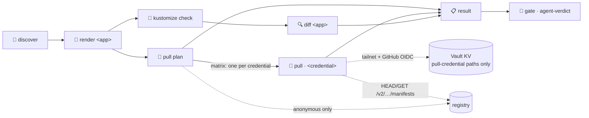

# image-pullability — verify every image with the cluster's own pull credential

| | |
|---|---|
| **Status** | **Proposed** (design only — Elephant step of the EGM loop; no workflow or TypeScript changes in this PR) |
| **Jira** | [INTEGRATE-63](https://planeodev.atlassian.net/browse/INTEGRATE-63) (this gate) · sibling [INTEGRATE-64](https://planeodev.atlassian.net/browse/INTEGRATE-64) (the pre-push Engram analyzer) |
| **Product** | devsecops-gitops — [`gitops-argocd-group.yaml`](../../../.github/workflows/gitops-argocd-group.yaml) |
| **Builds on** | [`actions/kubernetes/manifest-check`](../../../actions/kubernetes/manifest-check/README.md) (`objects.ts`, `imageref.ts`, `registry.ts`) and [`agent-verdict`](agent-verdict.md) |
| **Next** | Goldfish review (`egm-review`) → owner approval (the `LGTM:` comment / merge) → implementation PRs citing this file's merged URL |

## 1. Problem and evidence

A GitOps merge **is** a deploy. If the kubelet cannot pull an image the merge introduces, the deploy fails after
review and the failure spreads further than the one workload.

**The incident (2026-11-17).** [planeodev/planeo-infra#681](https://github.com/planeodev/planeo-infra/pull/681)
re-pinned `diagrams` to `ghcr.io/ohanalabs-ai/agentic-understanding-visualizer:main-32d4898`. The tag exists, and it
resolves with a human's credential. On EKS `planeo-prod` the pod went `ImagePullBackOff`:

- The pod pulls with the Secret `ghcr-pull` (`imagePullSecrets`).
- That Secret is an `ExternalSecret` from the `vault-kv` ClusterSecretStore: KV mount `planeo`, record
  `platform/services/ghcr.io/pull`, keys `username` + `token`, templated into a `kubernetes.io/dockerconfigjson`.
- That machine user (`pl-platformeng`) could not read the new **ohanalabs-ai** package. A private GHCR org package is
  readable only through the repository it is linked to. The fix was a manual grant: Read collaborator on
  `ohanalabs-ai/agentic-understanding-visualizer`.

The failure then cascaded through Argo CD:

1. `diagrams` went Degraded.
2. Its parents `platform` and `argocd-config` went Degraded.
3. The `hooks` app-of-apps stopped at sync wave 0.
4. An unrelated new Application (`paperclip-orgs`, wave 28) was never created.

**The gate already saw it, and passed it.** The PR's `🏗️ platform / 🧪 kustomize check` job (manifest-check)
reported this row and stayed green
([run](https://github.com/planeodev/planeo-infra/actions/runs/43987138796/job/133718614662)):

| image | available | auth |
|---|---|---|
| `ghcr.io/ohanalabs-ai/agentic-understanding-visualizer:main-32d4898` | ⚠️ 403 | github-token |

The finding was *"unverifiable with the github-token profile — DENIED"*: a **warning**, because
`FAIL_ON_UNVERIFIABLE=false`. The check asked with the **wrong identity** and got an **ambiguous answer**:

- The wrong identity: the CI's `GITHUB_TOKEN` for `planeodev/planeo-infra`, not the cluster's pull credential.
- The ambiguous answer: a 403 from an identity that is *not* the cluster's says nothing about the cluster. So
  "warn" was the only honest policy for that check.

Three conclusions follow:

1. "The tag exists" is the wrong question. A human's credential would pass, and CI's own token is ambiguous.
2. The only question that predicts the kubelet is: **can the credential the pod will present read this manifest?**
3. Once that credential is used, the ambiguity disappears. With the cluster's credential, a 403 or a GHCR "hidden"
   404 **is** an `ImagePullBackOff`. It can be a blocking error without false positives from "private but fine".

## 2. Outcome and how it is measured

**Outcome:** a PR that would make a pod fail to pull an image fails its 🚦 gate, with a typed reason and the fix,
before merge.

| # | Metric | Target | How it is measured |
|---|---|---|---|
| M1 | **Recall**: share of in-scope `ErrImagePull` / `ImagePullBackOff` incidents on Argo-managed clusters that the gate flagged on the PR that caused them | ≥ 90 % (baseline: 0 of 1, PR 681) | 30-day retro. `cluster-health-watch` findings (`ImagePullBackOff`) joined to the Argo CD `sync.revision` → merge commit → that PR's `image-pullability.json`. In scope = the registries and credential sources in §5. |
| M2 | **False-positive rate**: blocking findings that a re-run or a human proves wrong | ≤ 2 % of findings during warn-only. 0 for 14 days before switching to enforce. | `image-pullability.json` findings vs. a human `LGTM: override <image>` or a green re-run on the same SHA |
| M3 | **Cost** | PRs that touch no image: ≤ 20 s added (the plan job only). PRs that touch images: ≤ 2 runner-minutes added and ≤ 60 s on the critical path (p50). | Job durations from the Actions API over the warn-only window |
| M4 | **Leakage** | 0 credential bytes in logs, summaries, artifacts or comments | A canary credential in the self-test, `grep` over every artifact in CI; masked values asserted in tests |
| M5 | **Agent use** | 100 % of gate runs carry the `images` block in `gate.json`; agents cite it rather than logs | `gate.json` schema check in the agent-verdict self-test |

## 3. Constraints, assumptions, unknowns

### Verified constraints (evidence in hand)

| # | Constraint | Evidence |
|---|---|---|
| C1 | Actions logic is TypeScript via `actions/github-script` only, with no npm deps and no Python/bash logic. Jobs have emoji names, and every outcome writes a run summary with no secrets. | Owner rules; the `github-actions-cicd` skill; manifest-check is built this way |
| C2 | An OCI-distribution client with bearer-challenge, index-platform and GHCR hidden-404 handling **already exists** in `registry.ts`, along with image extraction in `objects.ts`. | `actions/kubernetes/manifest-check/*` + `manifest-check.test.ts` |
| C3 | Vault and Argo CD are **tailnet-only**. Any job that reads Vault must join the tailnet (`TS_OAUTH_*`, `tag:ci`) and log in with the job's GitHub OIDC JWT (`github-jwt` mount). | `prerequisites.md`; the `act` job |
| C4 | The callers' PR Vault roles bind `repository` + `event_name` (e.g. `gha-eks-cluster-pr`). Their policies do **not** include `platform/services/ghcr.io/pull` today. | planeo-infra `vault/README.md` (role table) |
| C5 | GHCR answers an under-privileged token for a private org package with **403 DENIED** (PR 681, `GITHUB_TOKEN`) **or** **404 MANIFEST_UNKNOWN** (ohanalabs-ai/k8s-infra PR 22). `tags/list` disambiguates. | manifest-check README; both runs |
| C6 | A private GHCR org package is readable by a user PAT only when the user can read the linked repository (or the package grants them directly). | The PR 681 fix (Read collaborator) and the `crane digest` that succeeded after it |
| C7 | The render artifacts (`rendered-<cluster>-<app>`) already hold the final images. Kustomize `images:`, Helm values and multi-source charts are all resolved by `🧩 render`. | `render-diff`; the PR 681 rendered diff shows the pinned tag |
| C8 | Units with `local=false` (external sources) are not rendered here. Their images cannot be checked by this repo's PR. | `unit-contract.md`, `verdicts.md` (`external`) |
| C9 | The kubelet only uses a pull Secret of type `kubernetes.io/dockerconfigjson` (or `dockercfg`). An `Opaque` Secret with the same content is silently ignored. | planeo-infra pull-secret comments (rekorda-operator, demo-scenario-mcp) |
| C10 | Some images are pulled by something other than the kubelet with pod `imagePullSecrets`. Substrate actor images are pulled by the `atelet` credential provider from `atelet-registry-auth` (`matchImages: ghcr.io/planeodev`). | planeo-infra `addons/README.md` (substrate rows) |

### Assumptions (believed, to be confirmed during warn-only)

| # | Assumption | If wrong |
|---|---|---|
| A1 | The Vault value today equals what ESO syncs into the cluster within `refreshInterval` (1 h on `ghcr-pull`). | A credential rotated within the last hour may disagree. The finding hint says so, and M2 catches it. |
| A2 | Most pull Secrets follow one ESO shape: a `template.data[".dockerconfigjson"]` whose `auths` keys are literal hosts, built from `data[]` entries (`remoteRef.key` + `property`). Credential records are `{username, token}` or `{username, password}`, or the Vault record holds a ready `.dockerconfigjson` (`dataFrom.extract`). | Template parsing returns `credential_unresolved`, and §11 Q7 (an explicit annotation) becomes the primary path |
| A3 | A ClusterSecretStore / SecretStore name maps to a fixed Vault KV mount + version per caller (e.g. `vault-kv` → `planeo`, KV v2). The caller declares that map. | Resolve from the store object when it is in the render; otherwise `credential_unresolved` |
| A4 | Docker Hub does not count `HEAD /manifests` against the anonymous pull limit, but does count `GET`. | `rate_limited` warnings rise. Use HEAD only for the tag, and `GET` once per image for the index. |
| A5 | At most a handful of distinct pull credentials appear per group (today one: `ghcr.io/pull`). | The per-credential matrix grows. GitHub's 256-job matrix cap is far away. |

### Unknowns (to resolve before or during implementation)

| # | Unknown | How we find out |
|---|---|---|
| U1 | Do **Dependabot** / Renovate PRs (the most common image bumps) get `id-token: write` and the `TS_OAUTH_*` secrets? Dependabot runs see only Dependabot secrets. | One test PR on planeo-infra in the warn-only phase. Fallback in §6.4. |
| U2 | Can a **fine-grained** PAT read cross-org GHCR packages? Today's credential is assumed to be a classic `read:packages` PAT. | Owner confirms the token type of `platform/services/ghcr.io/pull` (by metadata, never the value) |
| U3 | Which pull secrets do the CRD controllers attach? This covers the kagent `Harness`, Paperclip `Instance` and Substrate `WorkerPool` / `ActorTemplate`. | Read each controller's pod builder. One table row per kind (§5.1). |
| U4 | How many images on our clusters rely on **node-level** credentials (ECR via the node role, GAR via the node SA, kubelet credential providers, registry mirrors)? | One-off inventory across rendered units: images with no pull secret on a private registry |
| U5 | Does planeodev/customers use namespace-scoped `SecretStore`s per tenant with different Vault paths? | Read `env/*/` in the customers repo during the caller PR |

## 4. The smallest design (v1)

### 4.1 Shape

Two new jobs in `gitops-argocd-group.yaml`, both mode=diff only. One existing job grows.



**`🔑 pull plan`** (no secrets, no tailnet, no OIDC) parses untrusted PR content and does all of the following:

1. **Downloads** the group's `rendered-<cluster>-<app>` artifacts.
2. **Discovers images** with `objects.ts` plus a **CRD image-field table** (§5.1). Each image is attributed to its
   object, its field path, its namespace and the credential *rule* that applies to it.
3. **Resolves the credential** for each image (§5.2), down to a *credential reference*. A reference names where the
   credential lives: `vault:<mount>/<path>#<keys>` + `hosts[]`, `anonymous`, or `node:<registry>`. It **never**
   holds a value.
4. **Decides what it can on its own:**
   - `secret_in_git`
   - `credential_unresolved`
   - `credential_path_not_allowed`
   - everything for `anonymous` images: it checks them directly, with no secrets needed. `node:` images are not
     checked; they go to `not_verified` (§6).
5. **Emits a sanitized plan:**
   - `plan.json`: image refs validated by `imageref.ts`, each credential reference checked against the caller's
     allow-list and bound to the registry hosts its dockerconfig declares;
   - the dynamic matrix: one entry per credential reference that needs Vault. The key is a stable hash of the
     reference, and the label is human-readable (`ghcr.io · platform/services/ghcr.io/pull`).

**`🐳 pull · <credential>`** is a matrix job, one per credential reference, `fail-fast: false`. It runs in
`pr-environment` (`gitops`). It:

1. joins the tailnet;
2. runs `hashicorp/vault-action` with method `jwt`, using a **dedicated** role (§6.2);
3. reads exactly one path and **masks every value immediately** (`core.setSecret`);
4. checks that credential's images concurrently (cap 4) with `registry.ts`. The credential is only sent to the hosts
   it is bound to (§6.3).
5. writes a fragment `pull-<hash>.json` (typed results, no values) and revokes the Vault token (`actions/secrets/vault/revoke-token`).

**`📋 result`** (existing) gains these jobs in `needs`. It merges the plan and the fragments into
**`image-pullability.json`**, adds a `🐳 Image pullability` table to the group comment and the step summary (written on
every outcome), and folds an `images` block into `group.json`.

**`🧪 kustomize check`** (existing) keeps schema, removed APIs, floating tags and platforms for every image. When
pullability is enabled, it **drops its own availability verdict** for images that the plan routes to a cluster
credential. This stops the double report and the misleading `github-token` 403 row.

**Why the matrix is one job per credential, not one per image.** This challenges the original ask. Per image, each
job repeats the runner start (~10 s), the tailnet join (~10–20 s) and a Vault login, only to make 2–3 HTTP calls.
Per credential gives the same isolation where it matters:

- one job holds one secret;
- a failing credential does not hide another;
- each check gets its own row in the Checks UI.

Inside the job, `Promise.all` with a cap of 4 gives the same parallelism per image at a fraction of the cost. With
today's one shared credential, a group pays for **one** extra credentialed job. See §11 Q2.

### 4.2 Inputs (new, on `gitops-argocd-group.yaml`)

| Input | Default | Meaning |
|---|---|---|
| `image-pullability` | `warn` (v1) → `enforce` (v2) | `off` · `warn` (report only; the gate does not fail) · `enforce` (blocking findings fail the group) |
| `pull-credential-vault-role` | `""` | The dedicated Vault role (§6.2). Empty means credentialed images are reported as `not_verified` (`no-role`). |
| `secret-store-map` | `""` | Multiline `<kind>/<store-name>=<kv-mount>:<kv-version>`, e.g. `ClusterSecretStore/vault-kv=planeo:2` |
| `pull-credential-allowed-paths` | `""` | Multiline Vault path globs the gate may read, e.g. `platform/services/*.io/pull`. Anything else is `credential_path_not_allowed`. This is defence in depth on top of the Vault policy. |
| `pull-credential-map` | `""` | Optional fallback for Secrets defined in another unit: `<namespace>/<secret>=<store>:<path>` (§5.2 step 4) |
| `node-credential-registries` | `""` | Host globs pulled with node identity (e.g. `*.dkr.ecr.*.amazonaws.com`, `*-docker.pkg.dev`). Images on these hosts are reported as `not_verified` (`node-credential`). |
| `image-field-table` | `""` | Extra CRD image-field rows (YAML), merged over the built-in table (§5.1) |

The `required-platforms`, `vault-addr`, `vault-jwt-path` and `vault-jwt-audience` inputs and the `TS_OAUTH_*`
secrets are reused.

### 4.3 Outputs

**`image-pullability.json`**: artifact `image-pullability-<cluster>-<group>`, contract `planeo.dev/image-pullability/v1`.

```json
{
  "schema": "planeo.dev/image-pullability/v1",
  "cluster": "platform-aws-eks-use1-prd", "group": "platform",
  "repository": "planeodev/planeo-infra", "pr": 681, "sha": "<head sha>", "run_url": "…",
  "policy": "warn | enforce",
  "verdict": "pass | warn | fail | no-images",
  "credentials": [
    { "id": "c-3f9a1c2e", "kind": "vault", "store": "ClusterSecretStore/vault-kv",
      "vault_path": "planeo/data/platform/services/ghcr.io/pull", "keys": ["username", "token"],
      "hosts": ["ghcr.io"], "job": "🐳 pull · ghcr.io · platform/services/ghcr.io/pull", "status": "read-ok | read-denied | not-run" }
  ],
  "images": [
    { "image": "ghcr.io/ohanalabs-ai/agentic-understanding-visualizer:main-32d4898",
      "registry": "ghcr.io", "repository": "ohanalabs-ai/agentic-understanding-visualizer",
      "uses": [{ "app": "diagrams", "object": "Deployment diagrams/diagrams",
                 "path": "spec.template.spec.containers[0].image", "namespace": "diagrams",
                 "pull_secret": "diagrams/ghcr-pull", "secret_source": "ExternalSecret diagrams/ghcr-pull" }],
      "credential": "c-3f9a1c2e",
      "result": "unauthorized_with_cluster_credential",
      "http": { "manifest": 403, "repo_probe": 403 },
      "digest": "", "platforms": [], "missing_platforms": [],
      "blocking": true,
      "hint": "the cluster's GHCR credential cannot read ohanalabs-ai/agentic-understanding-visualizer — grant its user Read on the linked repository (or the package's access settings), then re-run" }
  ],
  "not_verified": [{ "image": "…", "reason": "node-credential | external-unit | fork | no-role | rate_limited | registry_unreachable" }],
  "counts": { "images": 2, "ok": 1, "blocking": 1, "warnings": 0, "not_verified": 0 }
}
```

It never contains a username, token, `auth` blob or dockerconfig. `vault_path`, `keys` and `hosts` are references,
not values.

**Result types** (one per image × credential):

| `result` | Blocking (enforce) | Means | Typical fix |
|---|---|---|---|
| `ok` | — | The manifest resolves with the cluster credential, and every required platform is present | — |
| `not_found` | yes | The repository is visible to the credential (`tags/list` 200), but the tag/digest is not | Fix the tag; wait for the build |
| `unauthorized_with_cluster_credential` | yes | The credential is valid, but this repository is not readable with it: 403 `DENIED`, or a GHCR hidden 404 with `tags/list` ≠ 200. **The PR 681 case.** | Grant the credential's user read on the package / linked repo |
| `credential_rejected` | yes | The token endpoint rejects the credential itself (401): expired, revoked or malformed | Rotate the Vault record |
| `denied` | yes | **No** pull secret applies (anonymous), and the registry refuses: the image is private | Add `imagePullSecrets` (the INTEGRATE-64 `pull_secret_missing` fact) |
| `platform_missing` | yes | The manifest lacks a `required-platforms` entry | Build multi-arch |
| `secret_in_git` | yes, **in both warn and enforce** | The applicable pull Secret is a plain `dockerconfigjson` / `dockercfg` Secret with `data` / `stringData` in the render | Replace it with an `ExternalSecret` → Vault, and rotate the leaked credential |
| `credential_unresolved` | no (v1); revisit in v2 | A pull secret is named, but its source cannot be traced to a Vault reference (another unit, an unknown template, no store map) | Add a `pull-credential-map` entry or the annotation (Q7) |
| `credential_path_not_allowed` | yes | The traced Vault path is outside `pull-credential-allowed-paths` | Use the platform record, or extend the allow-list in the caller (a reviewed change) |
| `rate_limited` | no | 429 after one backoff retry | Re-run; add a Docker Hub credential |
| `registry_unreachable` | no | Network error / 5xx after one retry | Re-run |

`credential_rejected` and `credential_path_not_allowed` are additions to the original list (§11 Q3).

### 4.4 How `agent-verdict` consumes it

This is an **additive** change to `planeo.dev/gitops-gate/v1`:

1. `gate.json` gains `images: [...]` with the blocking and warning findings, one per image, and the image summary
   counts.
2. A new unit `decision` value is added: **`fix-image-pull`**. It is blocking in enforce, and is set on the unit that
   deploys the image. It wins over `merge-ok` but not over `fix-render`. `next_actions` gets the typed `hint` and the
   job to open (`<group> / 🐳 pull · …`).
3. `not_verified` gains `image pull not verified for <image> (<reason>)` entries. Rule 2 for agents already makes
   them binding: never report such an image as verified.
4. Gate `verdict` in warn mode: findings appear, but `pass` stays `pass`. In enforce mode a blocking finding makes the
   group fail, and the gate `failed`.

Agents capture `image-pullability.json` next to `gate.json`. The DevSecOps specialist uses the `result` + `hint` to
draft the fix PR (for example, the package grant request). It never touches the credential.

## 5. Discovery and credential resolution

### 5.1 Images and their credential rule

`objects.ts` already finds containers, initContainers, ephemeralContainers and any `image` / `*Image` string. v1
adds a **table** that says *which credential applies* to each image field. A field that is not in the table falls
back to `pod-like` for pod templates, and `unknown` (warn, `credential_unresolved`) for other CRs.

| Kind (group) | Image field(s) | Credential rule |
|---|---|---|
| Pod, Deployment, StatefulSet, DaemonSet, ReplicaSet, Job, CronJob, Argo `Rollout` | `…spec.{containers,initContainers,ephemeralContainers}[].image` | `pod-like`: the pod's `imagePullSecrets`, else the SA's (`serviceAccountName`, default `default`) |
| kagent `Harness` | `spec.workload.image` | Per U3, likely `pod-like` with the field the controller copies (`spec.workload.imagePullSecrets`?) |
| Paperclip `Instance` (paperclip.inc) | `spec.image.*`, `spec.database.managed.image` | Per U3 |
| Substrate `WorkerPool` / `ActorTemplate` | `ateomImage`, `pauseImage`, actor images | `fixed-secret: ate-system/atelet-registry-auth` for `matchImages` hosts (C10) |
| Anything with `node-credential-registries` hosts | — | `node` → `not_verified` |

Rows live in `image-fields.yaml` next to the code. Callers extend the table with `image-field-table`. Every new row
needs a fixture test.

### 5.2 Credential chain (per image use)

1. **Pull secret names**: from the pod's `imagePullSecrets`. If there are none, from the ServiceAccount's
   `imagePullSecrets`. The SA must be in the render; if it is not, see step 4. If there are none at all, the image is
   `anonymous`. The kubelet tries every listed secret whose `auths` host matches the image host; the gate checks them
   in order, and the first `ok` wins. This mirrors the kubelet.
2. **The Secret, in the render**:
   - A `Secret` of type `dockerconfigjson` / `dockercfg` that carries `data` or `stringData` is **`secret_in_git`**.
     It is reported with the object, never the content. The gate does **not** use it to verify the image.
   - A `Secret` without data is created out of band, so it resolves through step 4.
3. **An `ExternalSecret`** whose `spec.target.name` matches, in the same namespace:
   - `secretStoreRef` + `secret-store-map` give the mount and KV version;
   - `data[].remoteRef.{key,property}` give the path and keys;
   - the template's `.dockerconfigjson` `auths` keys give the **bound hosts**;
   - which keys play username and password: the template expression (`"username":"{{ .X }}"`,
     `"password":"{{ .Y }}"`) or `printf "%s:%s" .X .Y`. Failing that, the key names `username` / `user` and
     `token` / `password`.
   - `dataFrom.extract` of a record that holds `.dockerconfigjson` is also accepted. Its hosts then come from the
     value at read time, **inside** the credentialed job.

   Anything else is `credential_unresolved`.
4. **Fallback**: the caller's `pull-credential-map` for Secrets owned by another unit, or created by an operator
   (e.g. rekorda-operator's per-namespace pull secrets). This is also where cross-unit SAs land. Otherwise the result
   is `credential_unresolved`.

The plan job writes this chain into `uses[]` (`pull_secret`, `secret_source`), so a reviewer and an agent see *why*
the gate chose a credential.

## 6. Security model

### 6.1 Where the credential exists

The credential exists **only** in the memory of one `🐳 pull · <credential>` job:

- It is masked on read, with `core.setSecret` on the username, the token and the derived `Basic` and `Bearer` values.
- It is never written to disk, `GITHUB_ENV`, outputs, artifacts or summaries.
- The Vault token is revoked at the end of the job (`if: always()`).
- The plan job never sees a credential.
- Only typed results leave the job.

The self-test includes a canary credential and asserts it appears nowhere in the outputs (M4).

### 6.2 Vault role scoping (least privilege)

The credential gets a **dedicated** role per caller, `gha-<repo>-image-pull-pr`. It is not added to the existing
`gha-eks-cluster-pr`. The role binds:

- `repository: <owner>/<repo>`, `event_name: pull_request`;
- **`job_workflow_ref: ohanalabs-ai/github-platform/.github/workflows/gitops-argocd-group.yaml@refs/heads/main`**.

That last claim is in every GitHub OIDC token of a reusable-workflow job. Binding it means that a PR that edits its
*caller* workflow (or adds a new one) cannot obtain this role from its own steps. Only this reviewed workflow at
`main` can use it.

The policy is `read` on exactly the pull-credential paths (today `planeo/data/platform/services/ghcr.io/pull`). It
has no `list` and no wildcard over `platform/services/*`.

`pull-credential-allowed-paths` repeats the allow-list inside the gate, so a mis-scoped policy still cannot be
steered by a PR.

### 6.3 What a malicious PR could try, and why it fails

| Attempt | Blocked by |
|---|---|
| Point an `ExternalSecret` at another Vault path (e.g. an Argo CD token), so the gate reads it | The role policy only grants the pull paths. The in-gate allow-list adds `credential_path_not_allowed`. Values are never echoed, even when read. |
| Use an image on an **attacker registry** (`evil.example/x`) with `imagePullSecrets: ghcr-pull`, so the gate sends the GHCR token there | **Host binding**: a credential is only sent to the hosts in its dockerconfig `auths`, exactly like the kubelet. For any other host the image is checked anonymously. |
| A registry whose `WWW-Authenticate` **realm** points to an attacker host | The realm host must equal the registry host, or be on a pinned per-registry list (`ghcr.io` → `ghcr.io`; `docker.io` → `auth.docker.io`). Otherwise the result is `registry_unreachable`, and no credential is sent. **This is a change to today's `registry.ts`**, which follows any realm. |
| Edit the caller to pass a different `pull-credential-vault-role` | The other role does not bind `job_workflow_ref`, or does not grant pull paths. A PR can already read what its repo's PR role grants; this design adds nothing to that. |
| Make the plan job leak data | The plan job has no secrets, no OIDC and no tailnet. |
| Flood the matrix (hundreds of fake credentials) | Allow-listed paths only. The matrix is capped (input default 20); anything beyond fails the plan. |
| Exfiltrate through timing / the result type | The result reveals only whether the platform credential can read a given repo. That is the information the PR needs; it is not a secret. |

### 6.4 PRs from forks, Dependabot, and no-tailnet callers

| Situation | Behaviour |
|---|---|
| Fork PR (no secrets, no OIDC) | The plan job still runs: `secret_in_git`, anonymous checks, `credential_unresolved`. Credentialed images get `not_verified: fork`, and the verdict says *"image pull not verified (fork)"*. The run is never green-as-verified. |
| Dependabot (U1) | Same as a fork, until U1 is answered. If Dependabot can get OIDC plus the tailnet secrets (Dependabot secrets), it is fully verified. |
| No `TS_OAUTH_*` or no role | `not_verified: no-tailnet` / `no-role`, like the existing `skipped-no-tailnet` |

## 7. Alternatives considered

| Alternative | Why not (v1) |
|---|---|
| **"Tag exists" with CI's own token** (today's manifest-check) | It is the PR 681 failure: the identity is wrong, so the answer is ambiguous. Kept for schema / platform / floating-tag checks. |
| **Extend the existing `🧪 kustomize check` job with Vault** (no new jobs) | This is the smallest diff, and the real runner-up. Rejected because one job would both parse untrusted PR content *and* hold the credential. It would also join the tailnet on every PR, even with no private image. Revisit if M3 shows the extra job costs too much (§10). |
| **One matrix job per image** (the original ask) | It repeats runner start + tailnet + Vault login per image for 2–3 HTTP calls, so N× the cost for no isolation gain. Per credential plus in-job concurrency gives the same signal (Q2). |
| **In-cluster dry-run pull** (a Job/Pod in a scratch namespace) | It is the most faithful: node credentials, mirrors, credential providers. But CI would need **write** access to the production cluster and node capacity, and it does a full pull (slow, with side effects). It also fails late on admission policies. A candidate for v2, only for `node`-credential images (§10). |
| **Kyverno `verifyImages` / policy-reporter** | Admission time is **after merge**, and the merge is the deploy, so it is too late to gate. Useful as runtime evidence for M1, not as the gate. |
| **`crane` / `skopeo` binaries** | They need a dockerconfig on disk (the credential on disk), plus binary pinning, and they break the TypeScript-only rule. `registry.ts` already speaks the protocol and is tested. |
| **Read the synced `Secret` from the cluster** (read-only kubeconfig) | It catches "ESO not synced". But it would grant CI read on Secrets in production, which the platform avoids on purpose. Vault is the source ESO reads from, so A1 covers the gap. |

## 8. Rollout and caller changes

| Phase | What | Exit criterion |
|---|---|---|
| 0 | Implementation PR in github-platform. Shared modules: `actions/kubernetes/image-pull/{plan,resolve,verify}.ts`, reusing `registry.ts` with the **realm pinning** fix and `objects.ts`. Fixtures + self-tests. A golden fixture reproduces PR 681. | The self-tests pass. The PR 681 fixture yields `unauthorized_with_cluster_credential`. The canary assertion passes. |
| 1 | **warn** on planeo-infra (`platform`, `core`, `product` groups), then demos and partners | 14 days. M2 ≤ 2 %, 0 false positives in the last 14 days, and M3 within target |
| 2 | **enforce** by default in the workflow. `image-pullability: warn` stays as an opt-out. `secret_in_git` has been blocking since phase 1. | Owner `LGTM:` on the phase-1 report |
| 3 | planeodev/customers and ohanalabs-ai/k8s-infra callers | Same as phase 1 per repo |

**planeodev/planeo-infra** (separate PRs, paired):

1. **Vault**, `vault/clusters/platform-aws-eks-use1-prd/github-actions/`: a role `gha-eks-cluster-image-pull-pr`
   (bound claims as in §6.2) and a policy `gha-image-pull-credential-reader` (`read` on
   `planeo/data/platform/services/ghcr.io/pull`). Plus the README role table.
2. **Callers** (`platform-gitops-pr-diff.yml`, `demos-…`, `partners-…`, `vault-…`): add
   - `image-pullability: warn`,
   - `pull-credential-vault-role`,
   - `secret-store-map: ClusterSecretStore/vault-kv=planeo:2`,
   - `pull-credential-allowed-paths`,
   - `pull-credential-map` for operator-created pull secrets (rekorda-operator, substrate).
3. **Docs**: README CI section, the `deploy-cluster` / `review-changes` skills, and a knowledge gotcha: *"a private
   GHCR org package must grant the cluster's pull user, not CI"*.

**planeodev/customers**:

- the same Vault role pattern (`gha-customers-image-pull-pr`);
- `secret-store-map` entries for any tenant `SecretStore` (U5).

**github-platform** (this product):

- `README.md` (capabilities, inputs, job names);
- `prerequisites.md` (the new role);
- `agent-verdict.md` + the action (`fix-image-pull`, `images`);
- `verdicts.md` (link).

The **Argo CD cascade** (one Degraded child stalls the `hooks` app-of-apps waves) is a separate planeo-infra concern.
This gate removes one cause, not the coupling. The cascade should be tracked in planeo-infra `BACKLOG.md`, not here.

## 9. Relationship with INTEGRATE-64 (Engram analyzer)

Both need the same function: **rendered manifests → (image, field, namespace, pull secret, secret source = ExternalSecret
`vault:<path>#keys` | plain Secret | none)**. The split:

| | INTEGRATE-64 (Engram, pre-push) | INTEGRATE-63 (this gate, PR) |
|---|---|---|
| When | After analysis, before push | On the PR, before merge |
| Reads credentials | **Never** | Yes: one allow-listed path, in one job |
| Decides | `secret_in_git` (CRITICAL), `pull_secret_missing` (static: private host with no secret) | Everything in §4.3, against the live registry with the cluster's credential |
| Output | engram-fragments (graph facts) | `image-pullability.json` + `gate.json` |

To keep the two in agreement, the mapping is a **contract**, not two implementations that drift:

- **`planeo.dev/image-pull-map/v1`**: the `uses[]` + `credentials[]` part of §4.3, without `result`;
- **shared fixtures** under `tests/fixtures/image-pull-map/` in github-platform (input manifests → expected map),
  including PR 681's units;
- the Engram analyzer runs the same fixtures in its CI. Whatever language it is written in, it must produce the
  identical map.

The CRD table (§5.1) is part of the contract; one file is consumed by both. INTEGRATE-64's `pull_secret_missing`
equals this gate's `denied`, found statically, without a registry call.

## 10. What evidence would change this design

| If we observe | Then |
|---|---|
| U4: many images on node-level credentials (ECR/GAR/credential providers) | Add a v2 tier: ECR via OIDC → `GetAuthorizationToken` with the *node role's* read policy, GAR via WIF as the node SA; or the in-cluster probe for that subset |
| A2 fails often (`credential_unresolved` > 10 % of credentialed images) | Make an explicit annotation the contract (`planeo.dev/pull-credential: vault:<path>#<keys>` on the ExternalSecret), verified against the template, rather than parsing it |
| M3: the extra job costs more than 60 s p50 on the critical path | Collapse into the `🧪 kustomize check` job (the runner-up in §7) |
| U1: Dependabot cannot get OIDC | Verify image bumps from bots in a `pull_request_target`-free path: a post-label re-run by a maintainer, or the refresh-mode pre-sync check |
| GHCR rate-limits token exchanges at our volume | Cache bearer tokens per (credential, repository) within the job; there is no cross-run cache, because tokens are secrets |
| M2 shows A1 mismatches (rotation lag) | Read ESO's `status.syncedResourceVersion` via the read-only kubeconfig (metadata only), and mark results as stale |

## 11. Questions for the owner (recommended defaults)

1. **Placement**: two new jobs, `🔑 pull plan` (no secrets) + `🐳 pull · <credential>` (matrix), feeding `📋 result`.
   **Default: yes.** The alternative is to extend `🧪 kustomize check` with Vault.
2. **Matrix granularity**: one job per **credential**, images concurrent inside (cap 4), instead of one job per
   image. **Default: per credential.**
3. **Result types**: adopt the owner's list **plus** `credential_rejected` (401 at the token endpoint) and
   `credential_path_not_allowed`. Define `denied` as "anonymous, and the image is private". **Default: yes.**
4. **Vault role**: a dedicated `gha-<repo>-image-pull-pr` per caller, bound to `job_workflow_ref` of this workflow at
   `main`, `read` on the pull paths only. Not added to `gha-eks-cluster-pr`. **Default: yes.**
5. **Rollout**: `warn` for 14 days on planeo-infra, then `enforce` by default. `secret_in_git` is blocking from day
   one. **Default: yes.**
6. **`credential_unresolved`**: a warning in v1, blocking from v2 once `pull-credential-map` covers the operator-made
   secrets. **Default: yes.**
7. **Credential tracing**: parse the ExternalSecret template in v1, and accept the optional annotation
   `planeo.dev/pull-credential` as an override. **Default: parse + optional annotation.** The alternative is to
   require the annotation.
8. **Node-credential registries** (ECR / GAR via node identity): out of scope in v1, reported as `not_verified`.
   **Default: yes.**
9. **Forks / Dependabot without OIDC**: run the plan job, and report credentialed images as `not_verified` (never
   green-as-verified). **Default: yes.**
10. **Realm pinning**: change the shared `registry.ts` so it never sends a credential to a realm host that is not
    pinned for that registry. This also hardens manifest-check. **Default: yes, in the phase-0 PR.**
11. **Contract**: publish `planeo.dev/image-pull-map/v1` + shared fixtures in github-platform as the INTEGRATE-64
    conformance suite. **Default: yes.**
12. **gate.json**: extend v1 additively (`images`, decision `fix-image-pull`) rather than bumping to v2.
    **Default: additive v1.**
13. **Docker Hub**: add an optional Docker Hub read credential to the pull paths, to avoid `rate_limited`.
    **Default: no** (warn on 429). Decide after phase 1.
14. **CRD table rows** for kagent `Harness`, Paperclip `Instance` and Substrate kinds: confirm U3 by reading each
    controller before phase 0 ends. Until then, these rows report `credential_unresolved`. **Default: yes.**

Answer with a comment: `LGTM: all` or `LGTM: all but N. …`
