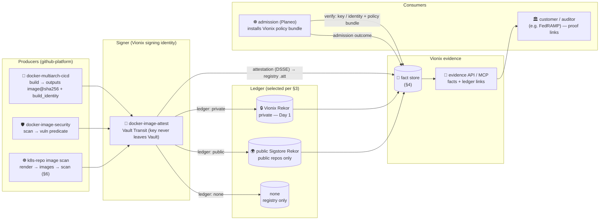
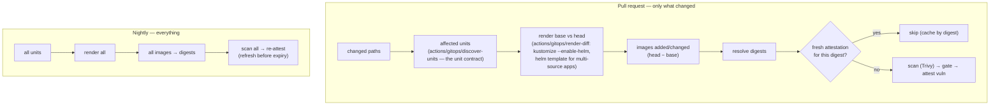

# Design: Vionix supply-chain evidence — ledgers, the "fact", and who owns what

Status: **design, documented only** (owner decisions 2026-10-12; Jira epic INTEGRATE-1). Nothing in
this document is implemented by this change. It records the decisions so the Vionix DevSecOps
platform (its own Kubernetes cluster and services are being designed next) builds against them.

Related: [`README.md`](README.md) (the CI context envelope),
[`docker-image-attest.yaml`](../../.github/workflows/docker-image-attest.yaml) (build → scan → attest),
the Planeo side: [`planeodev/planeo-infra` decision `vionix-owns-supply-chain-evidence-planeo-enforces`](https://github.com/planeodev/planeo-infra/blob/develop/knowledge/decisions/vionix-owns-supply-chain-evidence-planeo-enforces.md).

## 1. Decisions

| # | Decision |
|---|---|
| D1 | **Vionix runs its own Rekor — a private transparency log — from Day 1.** Customers, and any future party (e.g. US Government / FedRAMP assessors), get **links to the proofs**. The enterprise model has **zero data exposure** to public services: no repo name, workflow path or digest of a private build ever reaches a public log. |
| D2 | **When the source GitHub repository is PUBLIC, Vionix MUST support the public Sigstore Rekor** (keyless, public tlog) — by design, for customers who skip the GitHub signing model and for the open-source Vionix model. The private version keeps the **same interfaces**: Vionix surfaces the facts identically whichever ledger was used. |
| D3 | **Separation of concerns.** Vionix DevSecOps **owns**: the signing identity, the evidence (signature + provenance + SBOM + scan + admission outcome = the **fact**), the **policy definition** (what "approved build" means — ClusterImagePolicy/CUE or Kyverno, as a versioned **policy bundle** Vionix publishes), and the **evidence interface** (API/MCP surfacing facts with ledger links). A consuming platform (Planeo) only **hosts** keys (in its Vault, today) and **installs + enforces** Vionix's policy bundle at admission. |
| D4 | **Signing-token lifetime is a parameter**, not a constant (§5). |
| D5 | **A Kubernetes repository's images are all scanned and attested** — rendered from kustomize + Helm — **efficiently**: on a PR only the images whose render origin changed; nightly, all of them (§6). |

## 2. The flow



## 3. The ledger abstraction

One interface, three ledgers. The attest step (and every later evidence consumer) takes:

| Input | Values | Meaning |
|---|---|---|
| `ledger` | `auto` (default) \| `private` \| `public` \| `none` | `auto` = **public** if `github.event.repository.visibility == 'public'`, else **private** (once the Vionix Rekor exists; `none` until then — today's state) |
| `rekor-url` | URL | the private Rekor (`https://rekor.<vionix-domain>`); ignored for `public` (Sigstore's `https://rekor.sigstore.dev`) and `none` |
| `signing` | `key` (Vault Transit) \| `keyless` (Fulcio + GitHub OIDC) | `public` ledger may use either; `private` uses `key` (no public Fulcio) |

Outputs (identical whichever ledger): `ledger` (resolved), `log-index`, `entry-uuid`,
`entry-url` (a link a customer/auditor can open), `integrated-time`, `inclusion-proof` (checkpoint +
hashes, stored in the fact). With `none`: empty ledger fields, the attestation still in the registry.

Rules:
- **Private repo + `public` ledger is refused** (would publish the repo's name, workflow and digests).
- **Public repo** may choose `private` (a customer keeping its trail in-house) — `auto` picks `public`.
- The ledger choice is **recorded in the fact** and is part of the policy: the policy bundle can
  require "a ledger entry exists" (`ledger != none`) for a given image set.
- Today (github-platform #44): `--tlog-upload=false` ≡ `ledger: none`; it becomes `ledger: private`
  the day the Vionix Rekor is reachable — no caller change.

## 4. The "fact" (evidence record) — schema sketch

One record per **image digest × evidence event**, append-only, signed by Vionix:

```yaml
schema: vionix.dev/supply-chain-fact/v1
subject: { image: ghcr.io/<org>/<repo>@sha256:<digest>, digest: sha256:<digest> }
producer:
  builder_id: https://github.com/ohanalabs-ai/github-platform/.github/workflows/docker-multiarch-cicd.yaml@refs/heads/main
  source: { repository: <org>/<repo>, ref: refs/heads/main, sha: <commit> }
  run: { id: <run_id>, attempt: <n>, url: <run URL> }
signature: { key_ref: hashivault://<org>-ci-images, key_version: <n>, signature_ref: <registry ref of .sig/.att> }
attestations: [ { predicate_type: https://slsa.dev/provenance/v1, ref: <registry ref> },
                { predicate_type: https://spdx.dev/Document, ref: … },
                { predicate_type: https://cosign.sigstore.dev/attestation/vuln/v1, ref: … } ]
ledger: { kind: private|public|none, url: <rekor>, log_index: <n>, entry_uuid: <uuid>, entry_url: <link>, integrated_time: <ts> }
scan: { tool: trivy, db_version: <…>, scanned_at: <ts>, counts: {critical: 0, high: 2, …}, gate: pass|fail }
admission: [ { cluster: <id>, namespace: <ns>, decision: allow|warn|deny, policy_bundle: <name>@<version>, at: <ts> } ]
```

Served by the **evidence API / MCP** (`get_fact(digest)`, `list_facts(repo|image|time)`,
`proof_links(digest)`), so a customer or an assessor follows a link from an image to its ledger
entry, provenance, SBOM and scan — and Engram can ingest facts as `Attestation`/`SBOM`/`SecurityFinding` nodes.

## 5. Signing-token lifetime (D4)

- With build → scan → attest split (#44), the **Vault login happens only inside the attest job**, so a
  long *build* no longer races a 15-minute token. Signing itself takes seconds.
- Still, the lifetime is a **parameter**: per Vault role `tokenTTL` / `tokenMaxTTL` (default 15m,
  max e.g. 60m) — the role is the ceiling. A JWT login **cannot request a TTL above the role's**.
- The attest action gets an input (e.g. `vault-token-ttl`, ≤ the role max) and **renews** its token
  (`POST /v1/auth/token/renew-self`) up to the role max for long runs (e.g. attesting many images
  from a Kubernetes repo, §6); it always **revokes** the token at the end.

## 6. Kubernetes-repository image scanning (D5, extends INTEGRATE-31)

A repository full of kustomizations and Helm charts (planeo-infra, customers) references images that
nobody in the org built. Every one is scanned and stamped with a `vuln` attestation (key
`<org>-image-scan`, separate from the build key) so admission can require it.



- **PR = render origin changed only.** Changed paths → affected units (the gitops unit contract
  `{app,path,tier,local,multi_source,render_only,…}` already computed by `discover-units`) → render
  **base and head** (`render-diff` already does both) → the **image set difference** → digests →
  scan only digests without a fresh attestation. A PR touching one add-on scans that add-on's images.
- **Nightly = all images**, plus re-attesting digests whose attestation is about to expire (scan
  freshness is part of the admission policy, e.g. ≤ N days — a Rego policy, CUE has no clock).
- **Cache by digest**: an image digest with a still-fresh, valid `vuln` attestation is skipped on PRs
  and nightly; the digest is the cache key (tags are irrelevant).
- **Reuse**: the gitops render/discover machinery (`actions/gitops/*`) for units and rendering, and
  draft [#35](https://github.com/ohanalabs-ai/github-platform/pull/35)'s render → discover → digest →
  Trivy for image extraction and scanning — combined: #35's extractor runs over `render-diff`'s base/head
  outputs instead of rendering again.
- Gate per directory via a policy file in the caller repo (path glob → gate on/off, threshold), like
  Dependabot's directory model.

## 7. Day 1 of the Vionix platform

1. **Private Rekor** (+ its Trillian/log backend) reachable by the attest workflow and by customers'
   auditors (authenticated read); `ledger: auto` switches private repos from `none` to `private`.
2. **Public-repo path**: `ledger: public` (Sigstore Rekor, keyless allowed) behind the same interface.
3. **Evidence store + API/MCP** returning facts with ledger links.
4. **Policy bundle** published by Vionix (versioned), installed by consuming platforms; Planeo
   switches its ClusterImagePolicies to the bundle.
5. **Signing identity owned by Vionix** (keys may stay hosted in Planeo's Vault until the Vionix
   cluster hosts its own).
6. **Token TTL parameter + renewal** in the attest action.

## 8. Open

- Kyverno (`ImageValidatingPolicy`) vs Sigstore policy-controller for the policy bundle — still open
  (planeo-infra decisions conflict); the bundle format must be chosen with it.
- Where the Vionix Rekor and evidence store run (Vionix cluster design, upcoming).
- Retention and access model for proof links shared with external parties.
