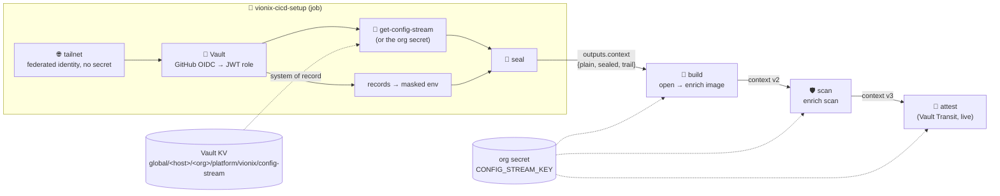

# Product: vionix-cicd

The **composition layer** of the Vionix CI/CD workflows: one **setup job** resolves everything a
pipeline needs (tailnet, Vault, configuration) and hands it to every later job as a single, versioned,
encrypted **context envelope**. The reusable workflows that do the work (build, scan, attest, …) keep
a clean interface — **one input `vionix-context` + one secret `CONFIG_STREAM_KEY`** — instead of
growing Vault/Tailscale inputs one feature at a time.

It is the owner's **config-stream encoder/decoder** pattern
([`ohanalabs-ai/ohana-github` `actions/build/config-stream-{encoder,decoder}`](https://github.com/ohanalabs-ai/ohana-github/tree/main/actions/build)
— a setup job tars + base64-encodes configuration into a job output, the consumer decodes it) re-done
**encrypted**: the original stream is plain base64, which GitHub's secret masking does not recognise
and which the runner logs with debug logging on.



## The context envelope — `vionix.dev/cicd-context/v1`

```json
{ "schema": "vionix.dev/cicd-context/v1", "version": 3,
  "plain":  { "org": "planeodev", "githubHost": "github.com",
              "registry": { "host": "ghcr.io" },
              "image": { "ref": "ghcr.io/planeodev/x@sha256:…", "digest": "sha256:…" } },
  "sealed": "<base64 iv|tag|AES-256-GCM ciphertext>",
  "trail":  [ { "stage": "setup", "job": "setup", "runAttempt": 1, "added": ["registry", "setup"] },
              { "stage": "build", "job": "ref-build", "runAttempt": 1, "added": ["image"] } ] }
```

Schema: [`schema/cicd-context.v1.schema.json`](schema/cicd-context.v1.schema.json). Implementation +
tests: [`actions/build/cicd-context`](../../actions/build/cicd-context/).

| Part | Why |
|---|---|
| `plain` | **YAML expressions can only read plaintext** — `if:`, matrices, `runs-on`, `needs.x.outputs` routing: `fromJSON(needs.setup.outputs.context).plain.image.digest`. Never a secret. |
| `sealed` | AES-256-GCM (Node's `crypto`, no npm), random 12-byte IV, AAD = canonical `{schema, version, plain, trail}` — **a tampered or mismatched readable part fails to open**. Values are strings, grouped by section; `open` masks every one (`core.setSecret`) before exporting it. |
| `trail` | Who added which section (stage, job, run attempt) — append-only provenance of the context itself. |
| rules | Sections are **append-only** (enrich never overwrites); unknown `schema` is rejected; the serialized envelope must stay **< 900 KB** (job outputs cap at 1 MB — reports/SBOMs go to artifacts, referenced by name). |

## Key distribution

`CONFIG_STREAM_KEY` (32 random bytes, base64) — **Vault is the system of record**, at a path derived
from where the workflow runs, so no caller passes it:

```
<kv-mount>/global/<github-host>/<github-org>/platform/vionix/config-stream   field CONFIG_STREAM_KEY
e.g.  planeo/global/github.com/planeodev/platform/vionix/config-stream
```

`vionix-config-stream-setup.yaml` creates it once (KV `cas: 0` — never overwritten by accident;
`rotate: true` = compare-and-set) and, with `push-org-secret`, copies it to the **org secret
`CONFIG_STREAM_KEY`** (visibility private). The copy exists because the **consuming** jobs must
decrypt without Vault — otherwise every build would join the tailnet again, which is what this
product removes. The setup job reads it from the caller's secret, else from Vault
(`get-config-stream`).

## Layout

| Path | What |
|---|---|
| [`.github/workflows/vionix-cicd-setup.yaml`](../../.github/workflows/vionix-cicd-setup.yaml) | the setup job: tailnet → Vault → key → seal → `outputs.context` |
| [`.github/workflows/vionix-config-stream-setup.yaml`](../../.github/workflows/vionix-config-stream-setup.yaml) | create / rotate the org's key (+ org-secret copy); callers wrap it in a `workflow_dispatch` |
| [`.github/workflows/vionix-config-stream-key-ohanalabs-ai.yaml`](../../.github/workflows/vionix-config-stream-key-ohanalabs-ai.yaml) | the **ohanalabs-ai** org's manual wrapper (dispatch from `main` — the admin role binds the reusable `@refs/heads/main`); planeodev's twin is `planeodev/planeo-infra` `.github/workflows/vionix-config-stream-setup.yml` |
| [`actions/build/cicd-context`](../../actions/build/cicd-context/) | `seal` · `open` · `enrich` the envelope |
| [`actions/secrets/vault/setup-config-stream`](../../actions/secrets/vault/setup-config-stream/) · [`get-config-stream`](../../actions/secrets/vault/get-config-stream/) · [`revoke-token`](../../actions/secrets/vault/revoke-token/) | the key in Vault; end the job's Vault token |
| [`actions/network/tailscale/join`](../../actions/network/tailscale/join/) | secretless tailnet join (org variables `TS_FEDERATED_CLIENT_ID` / `TS_FEDERATED_AUDIENCE`) |
| `products/vionix-cicd/manage-<capability>/<domain>/<verb>/action.yaml` | product-level compositions (the [ohana-github `products/ghes-ghas-enabler`](https://github.com/ohanalabs-ai/ohana-github/tree/main/products/ghes-ghas-enabler) convention) — none yet; the first ones arrive with the attest workflow |

## Using it

```yaml
jobs:
  setup:
    uses: ohanalabs-ai/github-platform/.github/workflows/vionix-cicd-setup.yaml@main
    permissions: { contents: read, id-token: write }
    with:
      vault-url: https://vault.platform.planeo.dev
      vault-role: gha-${{ github.repository_owner }}-cicd-setup
      join-tailscale: true
      tailscale-oauth-client-id: ${{ vars.TS_FEDERATED_CLIENT_ID }}
      tailscale-audience: ${{ vars.TS_FEDERATED_AUDIENCE }}
      plain-json: '{"registry":{"host":"ghcr.io"}}'
    secrets:
      CONFIG_STREAM_KEY: ${{ secrets.CONFIG_STREAM_KEY }}   # explicit — `secrets: inherit` does not cross orgs
  use:
    needs: setup
    runs-on: ubuntu-latest
    steps:
      - uses: ohanalabs-ai/github-platform/actions/build/cicd-context@main
        with: { mode: open, context: "${{ needs.setup.outputs.context }}", config-stream-key: "${{ secrets.CONFIG_STREAM_KEY }}" }
      # sealed values are now masked env vars; the readable part: fromJSON(needs.setup.outputs.context).plain
```

## Status and follow-ups

- 🐤 The chain is proven on demand by the signing canary ([devsecops-docker → Signing canary](../devsecops-docker/README.md#signing-canary--prove-an-orgs-chain-or-sign-any-digest)): build → scan → attest → public-key verify, or sign any digest.

This is the **design + building blocks** (INTEGRATE-29). Not here yet:

- ✅ `docker-multiarch-cicd.yaml` is a clean builder again (no Vault/Tailscale); it outputs
  `image_ref` + `build_identity` for the attest job
  ([#44](https://github.com/ohanalabs-ai/github-platform/pull/44)). **Still open:** accepting
  `vionix-context` and **enriching** it with `image` (ref + digests).
- ✅ `docker-image-attest.yaml` (build provenance or scan `vuln` → Vault Transit → cosign), absorbing
  [#43](https://github.com/ohanalabs-ai/github-platform/pull/43)'s `vault-sign` (#44). Signing stays a
  live Vault call in that one workflow — Transit keys never leave Vault, so it cannot be pre-fetched.
- planeo-infra Vault side ([planeodev/planeo-infra#402](https://github.com/planeodev/planeo-infra/pull/402)): roles `gha-<org>-cicd-setup` (read the config-stream path + listed records)
  and `gha-<org>-config-stream-admin` (create/update that path, dispatch only), and the `global/`
  folder in the Vault folder design.
- TLS to Vault: public CAs only (Node's `fetch` takes no per-request CA without npm `undici`).
